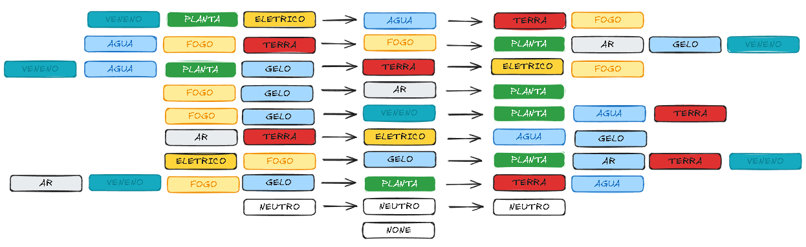

# apocalipse-brasil
Jogo sobre um Brasil pós apocaliptico

# Objetivo principal do jogo:
Aperfeiçoar meu JAVA e melhorar os GAPS dos primeiros jogos de pokemon. (RED, GOLD, EMERALD, DIAMOND, BLACK, X)
Jogos muito lentos no grind, e animações.

# Mudanças:
* [ ] Animações mais rapidas para ajudar no up
* [ ] Batalhas mais dinamicas
* [ ] Movimentos mais "realisticos"
* [ ] Historia mais pé no chão
* [ ] Historia baseada no Brasil, dividido nas regiões com suas caracteristicas

# Historia
Um mundo após uma grande guerra cidades e paises foram devastadas, populações reduzidas a cinzas, agora com uma radiação mais controlada, foram descobertas novas criaturas que ajudam e cooperam com os seres humanos restantes.
A devastação foi tamanha que a tecnologia foi perdida muitos lideres mundiais se foram e se instaurou uma anarquia tamanha que cada vila se juntou para poder sobreviver
As tais criaturas descobertas não sao de todo problema, elas cooperam conosco, o Brasil por ser um pais muito grande e diverso algumas areas como o nordeste que sofria com secas agora as criaturas nos ajudam a manter o ecossistema em equilibrio para vivermos.

# Efetividades

Explicação das efetividades
## Agua
- Terra, pode penetrar a terra, tornando em lama e escoando
- Fogo, Apaga o fogo (em certas condições)

## Fogo 
- Planta, Queima a planta
- Ar, O fogo consome o ar para se manter
- Gelo, Derrete o gelo
- Veneno, mata as bacterias e biorganismos

## Terra
- Eletrico, aterra deixando a eletricidade segura
- Fogo, apaga o fogo (em todas condições)
  
## Ar
- Planta, ventos fortes podem deslocar ou cortar

## Veneno
- Planta, mata a planta
- Agua, envenena a agua
- Terra, envenena a terra (radiação, pela terra a planta pode morrer)

## Eletrico
- Agua, se espalha pelos minerios da agua
- Ar, apenas com uma alta tensao se quebra a barreira diamagnetica
- Gelo, como na agua se espelha pelos minerios

## Gelo
- Planta, mata com geadas
- Ar, em voos resquicios de gelo sao um problema para aves e objetos voadores
- Terra, como derretimento do gelo se torna agua
- Veneno, congela as bacterias e microorganismos

## Planta
- Terra, com a terra a planta vive e se fortalece absorvendo os minerais e nutrientes
- Agua, a planta precisa de agua para sobreviver

## Neutro
- Neutro é como os ataques que sao atingtidos, como numa briga sendo efetivo e atacado ao mesmo tempo